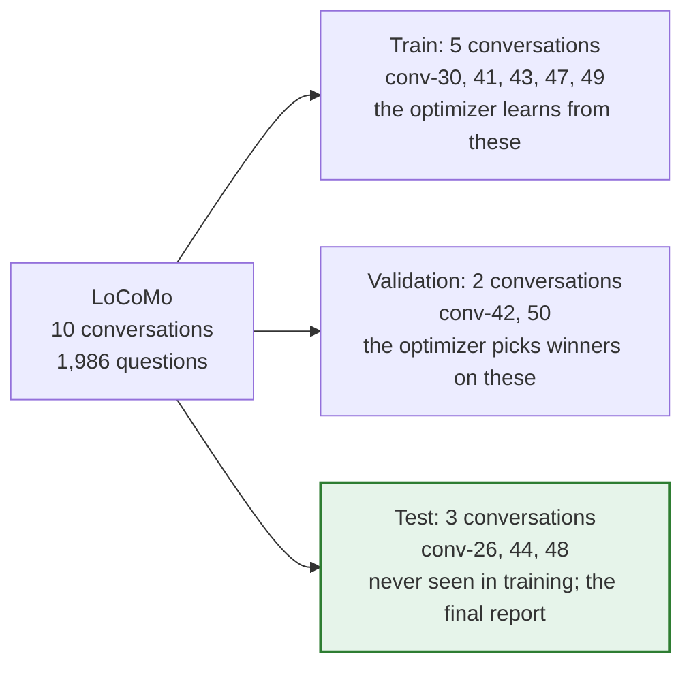
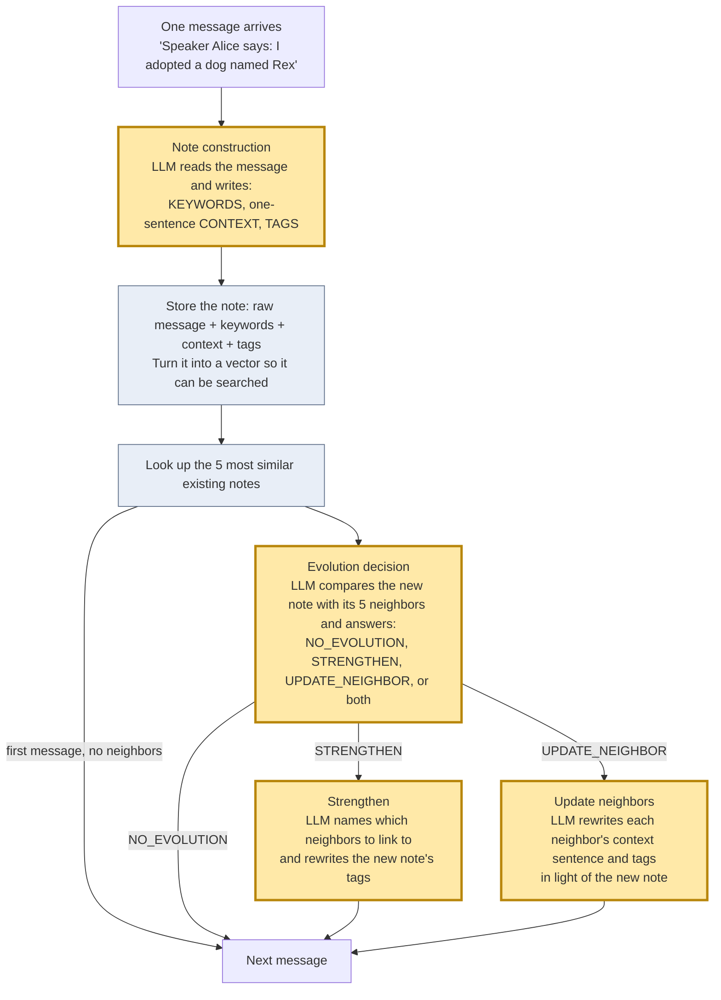
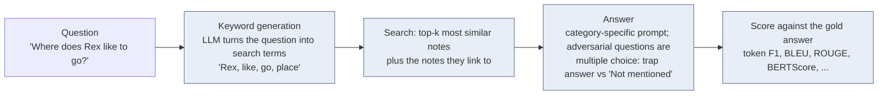
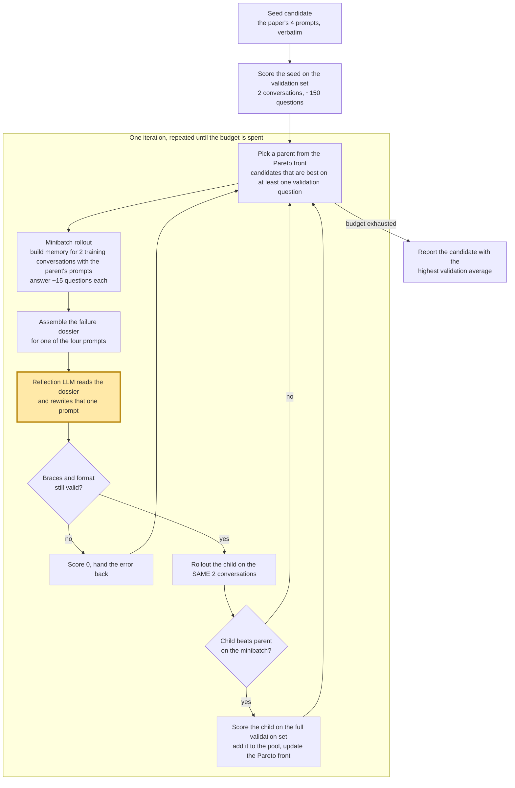
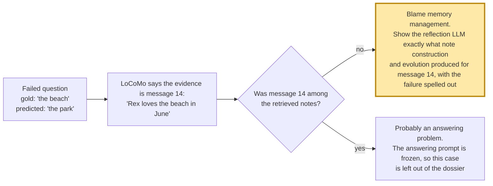
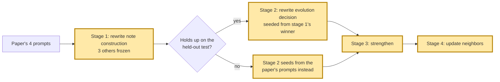

# How this project trains A-MEM's memory prompts, explained from scratch

New here? [03-training-walkthrough-for-everyone.md](03-training-walkthrough-for-everyone.md)
is the shorter, non-technical version of this document, covering the
current one-prompt-at-a-time process end to end. This one goes deeper.

This is the plain-language companion to the ADRs. It explains what the
system under test does, which parts we train, how the training loop works,
and why the project now has two pipelines that cannot be swapped for each
other. Orange boxes in the diagrams are the parts being trained. Grey boxes
are frozen.

Sources for every claim here: the vendored paper code in
`external/agentic-memory-repro/`, the adapter in `src/amem_gepa/`, and ADRs
[0013](decisions/0013-paper-reproduction-pipeline.md),
[0014](decisions/0014-gepa-targets-repro-pipeline.md),
[0015](decisions/0015-gepa-training-method.md),
[0017](decisions/0017-gepa-local-model-progress-and-resume.md) and
[0019](decisions/0019-sequential-single-prompt-training.md).

## 1. The story in one paragraph

A-MEM is a memory system for chatbots. As a long conversation unfolds, it
writes a small index card for every message, files the card next to related
cards, and occasionally rewrites older cards in light of new ones. Later,
when asked a question about the conversation, it pulls the most relevant
cards and answers from them. Every one of those filing decisions is made by
a language model following a written instruction, a *prompt*. The A-MEM
paper wrote those prompts by hand. This project asks: if we let an
optimizer rewrite the filing instructions, using only the final
question-answering score as feedback, do the answers get better?

## 2. The benchmark: LoCoMo

LoCoMo is a set of 10 very long two-person conversations, each spanning
many sessions over months, with 1,986 questions whose answers are buried in
the transcripts. Questions come in five kinds:

| category | what it tests | example shape |
|---|---|---|
| single-hop | one fact from one message | "What breed is Rex?" |
| multi-hop | combine facts from several messages | "Which pet did she adopt after moving?" |
| temporal | dates and ordering | "When did they move to Lisbon?" |
| open-domain | conversation plus world knowledge | "What cuisine is the restaurant she mentioned known for?" |
| adversarial | a trap: the fact is *not* in the conversation | "What color is Rex's collar?" (never said) |

The paper evaluates on all 10 conversations. An optimizer needs data it can
learn from and data it has never seen, so this project splits the 10
conversations three ways and never lets training touch the test set
([ADR 0004](decisions/0004-train-val-test-split.md)).



The split is by *conversation*, not by question, because memory is built
from a whole conversation before any question is asked. Splitting by
question would leak the transcript into the test set.

## 3. How A-MEM remembers: building memory one message at a time

The conversation is replayed message by message. For each message the
system makes between one and four language-model calls. The orange boxes
are the four prompts this project trains.



What each trained prompt controls, in plain terms:

- **Note construction** decides *what the card says about the message*. The
  raw message is always stored verbatim, so this prompt does not change
  the facts. It changes the keywords, summary and tags that sit next to
  the facts, and those are what the search step actually matches against.
  A card that never mentions "beach" will not be found by a question about
  the beach.
- **Evolution decision** decides *whether filing work is needed at all*.
  Say NO_EVOLUTION too often and notes never get linked. Say STRENGTHEN too
  often and every note gets wired to everything.
- **Strengthen** decides *which cards get linked*. Links matter because at
  answer time, retrieving a card also drags in the cards it links to.
- **Update neighbors** decides *how old cards get rewritten*. This is the
  riskiest step: a bad rewrite can erase the one word that a later
  question needed.

The two grey steps, vectorizing and nearest-neighbor search, are plain
math with no prompt. Nothing to train there.

## 4. How A-MEM answers: nothing here is trained



Every box here is deliberately frozen, identical for the baseline and for
every trained candidate. The reason is isolation: if the answering prompt
could also change, a higher score might come from better answer phrasing
rather than better memory. Holding this half fixed means any difference in
score is attributable to the four memory prompts alone
([ADR 0006](decisions/0006-qa-answer-prompt.md), carried into 0014).

The trained prompts still affect this stage, but only indirectly, through
what the memory contains: which cards exist, what their keywords say, and
what they link to.

## 5. What a "candidate" is

A candidate is simply four text files, one per orange box. The starting
candidate, called the seed, is the paper's own four prompts copied byte
for byte from the vendored code. Here is the seed's evolution-decision
prompt, with its fill-in-the-blank slots in braces:

```
You are an AI memory evolution agent. Analyze the new memory note and its
nearest neighbors to decide if evolution is needed.

New memory:
- Context: {context}
- Content: {content}
- Keywords: {keywords}

Nearest neighbor memories:
{nearest_neighbors_memories}

Based on the relationships between the new memory and its neighbors, decide:
- NO_EVOLUTION: The memory stands alone, no changes needed.
- STRENGTHEN: ...
- UPDATE_NEIGHBOR: ...
- STRENGTHEN_AND_UPDATE: Both strengthen and update neighbors.

Respond using EXACTLY this format:
DECISION: <one of NO_EVOLUTION, STRENGTHEN, UPDATE_NEIGHBOR, STRENGTHEN_AND_UPDATE>
REASON: <brief explanation>
```

The optimizer may rewrite any of the wording. Two things are
non-negotiable, and are checked before a candidate is allowed to run: the
braces must stay exactly as they are, because the surrounding code fills
them in, and the answer format must stay parseable, because a fixed parser
reads the `DECISION:` line. A candidate that breaks either rule scores
zero without spending anything, and the error message is handed back to
the optimizer so the next attempt can fix it.

### 5.1 Where the paper says this, and where it does not

The four boxes map onto the paper (arXiv 2502.12110) like this:

| box in section 3 | paper text | paper prompt | paper's own code (Feb 2025) | reproduction repo's "robust" code (Mar 2026), what we train |
|---|---|---|---|---|
| Note construction | §3.1, Eq. 1-3: LLM writes keywords, context, tags | Appendix B.1, P_s1 | one JSON call | one plain-text call |
| Evolution decision | §3.2 Eq. 6 "analyze potential connections"; §3.3 "determines whether to update" | P_s2 ends with "Should this memory be evolved?"; P_s3 has a `should_evolve` flag and an `actions` list | folded into one JSON call together with the two rows below | its own call, answering `DECISION:` |
| Strengthen | §3.2 Eq. 6: the link set L_n for the new note | P_s3: "which memory should it be connected to", "updated tags" | same single JSON call (`suggested_connections`, `tags_to_update`) | its own call, run only if the decision said STRENGTHEN |
| Update neighbors | §3.3 Eq. 7: evolved neighbor m_j* replaces m_j | P_s3: "update the context and tags of these memories" | same single JSON call (`new_context_neighborhood`, `new_tags_neighborhood`) | its own call, run only if the decision said UPDATE_NEIGHBOR |

So the *decision* is in the paper, but not as a separate step. The paper
describes two conceptual operations, link generation (§3.2) and memory
evolution (§3.3), and its released code implements both in a single LLM
call that returns one JSON object with a `should_evolve` boolean, an
`actions` list and all the link and rewrite fields at once. The explicit
three-way split, decide first and then run only the actions chosen, was
introduced by the repository maintainers in March 2026 in the "robust"
evaluation path, which removes the JSON-schema dependency so the pipeline
runs on any backend. That robust path is what `run_all_experiments.sh`
drives and what this project vendored and trains
([ADR 0013](decisions/0013-paper-reproduction-pipeline.md)).

Two consequences worth keeping in mind:

- The seed candidate is the paper's prompts as *re-expressed by the
  maintainers' robust code*, byte for byte, not the appendix prompts byte
  for byte. The wording and the semantics (the same four decisions over
  the same five neighbors) are the paper's; the decomposition into three
  calls is not.
- In the paper's text the evolution step reuses the top-k neighbors from
  retrieval. In both the original and the robust code the neighbor count
  for evolution is fixed at 5, independent of the retrieval k used at
  answer time. The decision box compares the new note with exactly 5
  neighbors for that reason.

## 6. How GEPA trains a prompt

GEPA stands for Genetic-Pareto. The everyday analogy is a coach who
watches game tape. The coach does not see the player's brain, only the
plays and the outcomes, and writes better instructions for next time.

### 6.1 One rollout

A rollout is: take a candidate's four prompts, build memory for one whole
training conversation from scratch (section 3), then answer a handful of
that conversation's questions (section 4) and score them. Each training
item is one conversation plus up to 3 questions from each of the 5
categories, about 15 questions, so one memory build is amortized over 15
scores. The fixed per-category quota exists because multi-hop and
open-domain questions are scarce; a random draw would show them to the
coach too rarely to ever improve them.

### 6.2 The loop



Three ideas make this more than random guessing:

- **Reflection, not mutation.** A genetic algorithm would flip random
  words. GEPA shows a second language model the actual failures and asks
  it to reason about *why* and rewrite accordingly. One prompt is
  rewritten per iteration, so the coach's feedback is targeted.
- **Minibatch before full validation.** Rewrites are first checked on the
  same two conversations the parent just ran. Only a child that wins that
  cheap comparison earns the expensive full validation run.
- **Pareto front, not a single leaderboard.** GEPA keeps every candidate
  that is the best on *at least one* validation question, not only the one
  with the best average. A candidate that is brilliant on temporal
  questions but mediocre overall stays alive and can be the parent of the
  next rewrite. This is what keeps the scarce categories from being
  averaged away.

### 6.3 The failure dossier: how blame is assigned

The reflection model is only useful if it is shown the right evidence.
LoCoMo tells us, for every question, which message in the transcript holds
the answer. That lets the adapter decide whether a wrong answer is the
memory's fault or the answering step's fault.



Each dossier entry pairs an input (the message), the trained prompt's
output for it (the card it wrote, or the evolution decision it made) and
the downstream consequence (the question that later failed because that
card was never found). The brace and format rules from section 5 are
appended to every entry so the coach never forgets them.

#### The reflection prompt, verbatim

The adapter does not supply its own proposer (`propose_new_texts = None`)
or a `reflection_prompt_template`, so the reflection model receives
GEPA's default template (`gepa/strategies/instruction_proposal.py`,
gepa 0.1.4):

````
I provided an assistant with the following instructions to perform a task for me:
```
<curr_param>
```

The following are examples of different task inputs provided to the assistant along with the assistant's response for each of them, and some feedback on how the assistant's response could be better:
```
<side_info>
```

Your task is to write a new instruction for the assistant.

Read the inputs carefully and identify the input format and infer detailed task description about the task I wish to solve with the assistant.

Read all the assistant responses and the corresponding feedback. Identify all niche and domain specific factual information about the task and include it in the instruction, as a lot of it may not be available to the assistant in the future. The assistant may have utilized a generalizable strategy to solve the task, if so, include that in the instruction as well.

Provide the new instructions within ``` blocks.
````

`<curr_param>` is the current text of the one component being rewritten.
`<side_info>` is `make_reflective_dataset`'s output for that component
(at most `max_reflection_examples`, default 5), rendered by GEPA as
markdown: `# Example N`, then `## Inputs`, `## Generated Outputs`,
`## Feedback`. For note construction an example looks like:

```
# Example 1
## Inputs
### turn_content (the {content} input)
Rex loves the beach in June
### question_later_asked
Where does Rex like to go?
## Generated Outputs
KEYWORDS: Rex, June
CONTEXT: Rex enjoys a seasonal activity.
TAGS: pets, summer
## Feedback
A later single_hop question ('Where does Rex like to go?', gold 'the beach')
FAILED (predicted 'the park', score 0.00) and this evidence turn was NOT
among the retrieved memories. The keywords/context/tags produced below are
what retrieval embeds and matches against -- they did not surface this turn
for that question. Dates/times, entities, and relations the question hinges
on need to be recoverable from them. CONSTRAINT: the rewritten prompt is a
Python str.format template and must contain exactly these placeholders:
{content} -- no other placeholders, and any literal brace must be doubled
('{{' / '}}'). It must also keep an explicitly parseable output format,
since the response is consumed by a fixed plain-text parser.
```

The model's reply is parsed for the last fenced block, which becomes the
new text of that component. The template is GEPA's, not ours; replacing
it (`reflection_prompt_template=` in `gepa.optimize`) would be a separate,
recorded decision.

Which model plays the coach, and whether it thinks before answering, is
configuration ([ADR 0020](decisions/0020-thinking-mode-config-and-claude-coach.md)):
`GEPA_REFLECTION_LM` names it (`ollama/qwen3.5:9b` for the local model
experiments 004/005 used, `anthropic/claude-opus-5-5` for Claude through
the official SDK), and `gepa.reflection` in the config sets thinking, effort,
max tokens and a spend cap. The task model's own thinking mode is a
separate knob, `paper_repro.thinking`, off by default (ADR 0016) and shared
by every tool that builds memory so both arms of a comparison always match.

### 6.4 The adversarial twist

The paper's own scoring for trap questions is ambiguous: its code scores
the model's answer against the trap text, which would reward falling for
the trap ([ADR 0013](decisions/0013-paper-reproduction-pipeline.md)
documents this and leaves it open). An optimizer pushes hard on whatever
it is rewarded for, so training uses the paper's *stated intent* instead:
a trap question scores 1 when the model picks "Not mentioned in the
conversation" and 0 otherwise. The final test report shows both readings
so the number stays comparable to the earlier experiments.

### 6.5 Training one prompt at a time

The loop above, as GEPA ships it, rotates through the four orange boxes:
iteration one rewrites note construction, iteration two the evolution
decision, and so on. The first full run
([experiment 004](experiments/004-gepa-v1-qwen3.5-9b.md)) did exactly
that, and its winner differed from the paper's prompts in all four
files. That made the result impossible to read: a gain on validation
that turned into a loss on the test conversations, with no way to say
which of the four rewrites helped and which hurt.

So the project now trains one prompt per run, with the other three
frozen byte for byte at the run's starting point
([ADR 0019](decisions/0019-sequential-single-prompt-training.md)). The
coach, to stay with the analogy, works on one skill at a time. Stage one
is note construction, because it is upstream of everything else: its
keywords and summary are what the search step matches on and what the
three evolution prompts read. Then the evolution decision, then
strengthen, then update neighbors, each stage starting from the previous
stage's winner.



Two safeguards keep "frozen" honest. GEPA is told to always pick the
same component for rewriting, and GEPA only ever copies the parent and
replaces the components it was told to rewrite, so the other three
cannot drift. Independently of that, the adapter checks every candidate
it is asked to score against the frozen texts and gives a changed one a
zero without building any memory, the same way it treats a prompt with a
broken placeholder.

The price is that a change which only helps in combination with a change
to another prompt will not be found. The gain is that every stage
produces one changed file whose effect can be measured on its own, and
the held-out check between stages catches a validation-only gain before
it is baked into the next three stages.

## 7. Why it is slow, and what was done about it

Every new candidate changes the prompts that build memory, so memory
cannot be reused across candidates. The expensive unit is therefore the
*build*, not the question.

| unit of work | measured in the first real run on `qwen3.5:9b` |
|---|---|
| build memory for one full conversation | about 89 minutes |
| answer one question | about 6 seconds |
| whole run: 98 builds, 3,059 questions, 14 candidates | 6.3 days, 96 percent of it building |

Things the adapter does to cope ([ADR 0015](decisions/0015-gepa-training-method.md),
[ADR 0017](decisions/0017-gepa-local-model-progress-and-resume.md)):

- **Build cache.** Every finished build is saved on disk keyed by the
  candidate's content hash and the conversation. Re-scoring a parent, or
  resuming after a crash, costs zero builds. In the first run 53 of 151
  build requests were served from cache.
- **Mid-build checkpoints.** A build in progress snapshots itself every
  20 messages, so a kill costs at most 20 messages of work.
- **Resume.** Rerunning with the same run label reloads GEPA's state, the
  cache, and the partial checkpoints.
- **Progress and ETA** lines during builds and question answering, plus a
  run-level line with the budget consumed.

## 8. The two pipelines, and whether the gap is just a translation problem

The project has a second, older pipeline that predates the discovery of
the paper's real code. The question raised was whether a candidate trained
on the paper pipeline could be evaluated on the older one by translating
the prompt files. The short answer is no. File names and placeholders are
the visible part of the gap; underneath, the two pipelines make different
decisions, retrieve differently, answer differently and score differently.

```mermaid
flowchart TD
    subgraph A["Legacy library pipeline: just eval, just baseline"]
        A1["Note construction<br/>1 prompt, JSON output"]
        A1 --> A2["Evolution<br/>1 prompt that decides, links AND rewrites neighbors<br/>in a single JSON answer; names neighbors by memory ID"]
        A2 --> A3["Retrieval<br/>embed the raw question"]
        A3 --> A4["Answer<br/>one project-written prompt for all categories<br/>adversarial = open-ended, must say 'not mentioned'"]
        A4 --> A5["Score<br/>metrics.py, ported from a different repo"]
    end
    subgraph B["Paper reproduction pipeline: just reproduce, GEPA"]
        B1["Note construction<br/>1 prompt, labelled plain-text sections"]
        B1 --> B2["Evolution decision<br/>plain text, DECISION: line"]
        B2 -->|STRENGTHEN| B3["Strengthen<br/>neighbors by position 0..4"]
        B2 -->|UPDATE_NEIGHBOR| B4["Update neighbors<br/>one block per neighbor"]
        B2 -->|NO_EVOLUTION| B5
        B3 --> B5["Retrieval<br/>LLM turns the question into keywords, then embed"]
        B4 --> B5
        B5 --> B6["Answer<br/>paper's category-specific prompts<br/>adversarial = multiple choice"]
        B6 --> B7["Score<br/>paper's own calculate_metrics suite"]
    end
    classDef trained fill:#ffe9a8,stroke:#b8860b,stroke-width:3px
    classDef legacy fill:#f6e0e0,stroke:#a94442
    class B1,B2,B3,B4 trained
    class A1,A2,A3,A4,A5 legacy
```



Layer by layer, what a translation would have to do:

| layer | legacy pipeline | paper pipeline | translatable? |
|---|---|---|---|
| note construction | one prompt, JSON out | one prompt, `KEYWORDS:`/`CONTEXT:`/`TAGS:` out | **Mostly.** Same single `{content}` slot; only the output-format instructions differ. |
| evolution | one prompt returns a JSON object with *all* of: should_evolve, actions, connections, new tags, new neighbor contexts, new neighbor tags | three prompts, called conditionally: decide first, then strengthen only if STRENGTHEN, then update only if UPDATE_NEIGHBOR | **No.** The trained artifact includes a *decision* prompt whose whole job is choosing which of the other two to run. The legacy pipeline has no such step; it asks for everything at once. Three conditional instructions cannot be collapsed into one unconditional one without changing what the model is asked to decide. |
| neighbor identity | by memory ID string; the model often fabricated IDs ([ADR 0012](decisions/0012-evolution-decision-guard.md)) | by position 0 to 4 in the shown list | **No.** The trained strengthen prompt teaches the model to answer `CONNECTIONS: 0, 2`; the legacy code would look up a note with ID "0" and find nothing. |
| retrieval | embed the raw question | an LLM rewrites the question into keywords first | **Not a prompt.** It is a pipeline step the legacy code lacks. A trained note-construction prompt was optimized to be found by *keyword* queries. |
| answering | one project-written prompt; trap questions must produce the phrase "not mentioned" unprompted | paper's per-category prompts; trap questions are a two-option multiple choice | **Not a prompt we own.** Different task given to the model, so the same memory yields different answers and especially different adversarial scores. |
| scoring | comma-split multi-hop, refusal-phrase adversarial, from another repo | uniform `calculate_metrics` suite over every category | **Different numbers.** Even identical answers would score differently. |

So the gap is contractual on the surface and behavioral underneath. You
could rewrite the note-construction file into the legacy format in a few
minutes. You cannot produce a legacy evolution prompt that means the same
thing as the three trained ones, because the legacy pipeline never asks
the question the decision prompt answers. And even a perfect translation
would then be run through a different retriever, a different answering
prompt and a different scorer, so the resulting number could not be
compared with the baseline the training was aimed at
([experiment 003](experiments/003-qwen3.5-9b-exploration.md)).

The practical consequence: the held-out test comparison has to run on the
paper pipeline, with the paper's prompts as the baseline and the trained
four files as the candidate, through the same adapter that trained them.
The legacy `just eval` is for the legacy pipeline only.

That tool now exists: `just gepa-test-eval <candidate dir>`
([ADR 0018](decisions/0018-held-out-test-comparison.md)). It runs both arms
through the adapter on every question of the three test conversations,
scores with the paper's suite, and reports the candidate-minus-baseline
difference with a paired bootstrap interval.

## 9. Glossary

- **A-MEM.** The agentic memory system from the paper; stores a note per
  message and evolves notes as new ones arrive.
- **Note.** One stored message plus its keywords, one-sentence context,
  tags and links to other notes.
- **Evolution.** The step that may link a new note to neighbors and
  rewrite neighbors' context and tags.
- **Candidate.** A set of four prompt files. The seed candidate is the
  paper's own prompts.
- **Build.** Replaying one whole conversation through a candidate's
  prompts to produce its memory. The expensive unit.
- **Rollout.** One build plus answering and scoring a batch of questions.
- **Reflection LLM.** The "coach" model that reads failures and rewrites
  one prompt. Separate from the task model that builds memory and answers.
- **Pareto front.** The set of candidates that are best on at least one
  validation question.
- **Metric call.** GEPA's budget unit: one scored item. The config's
  budget of 2,000 is in these, but wall-clock is dominated by builds.
