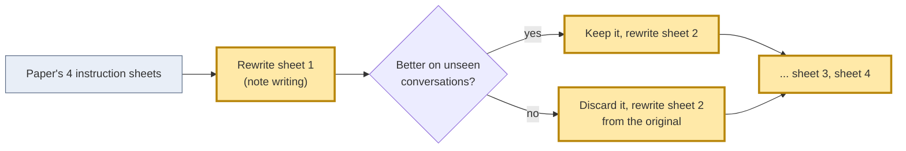
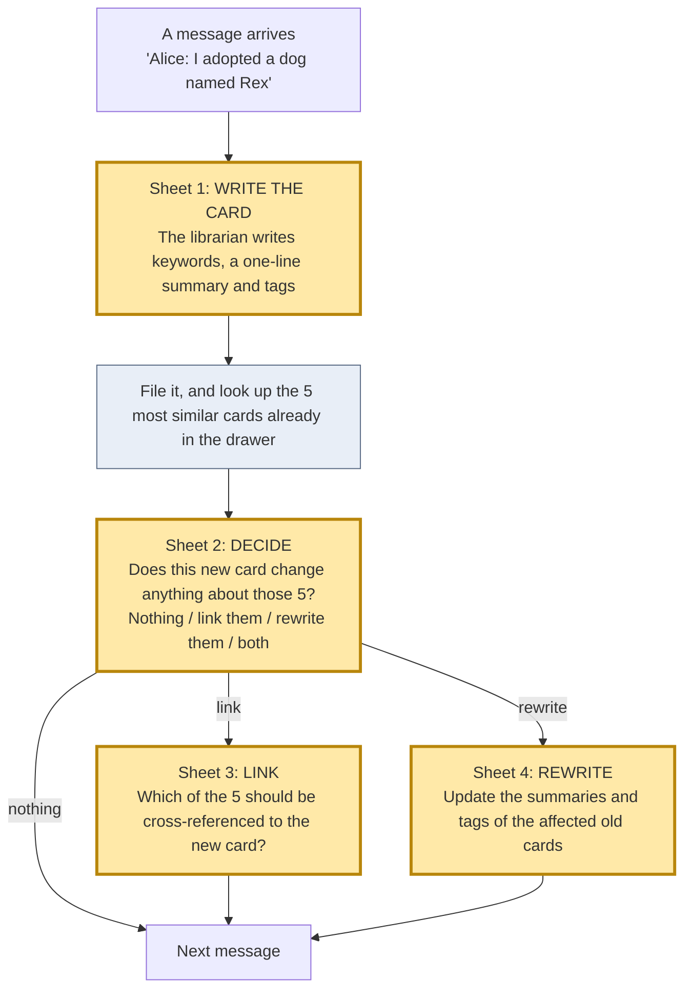
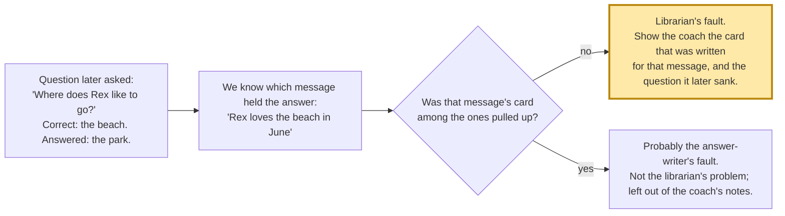
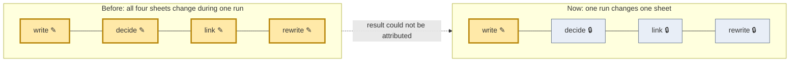
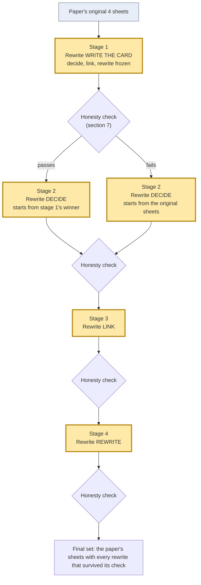
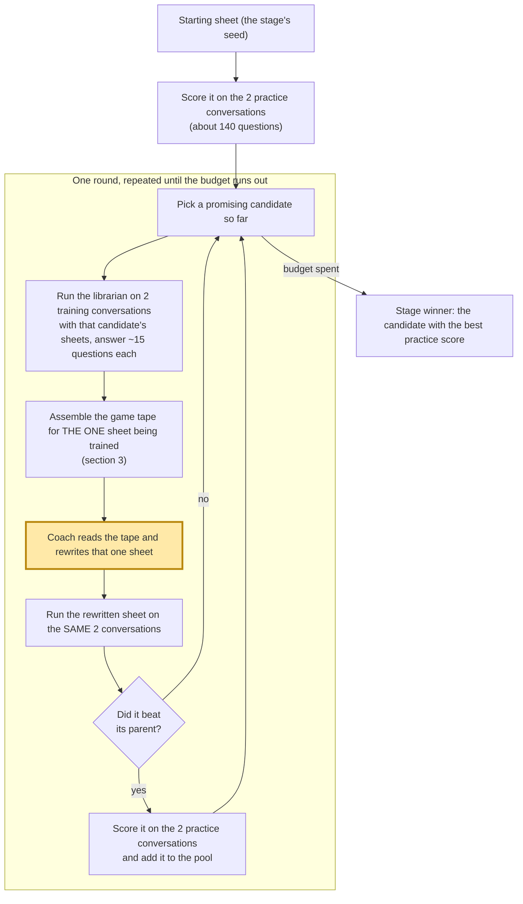
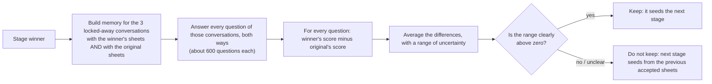
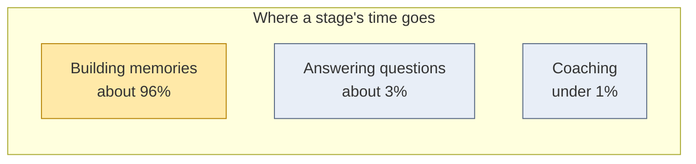

# How we train the memory prompts, explained for everyone

This is the non-technical walkthrough of the training process as it works
today: one prompt at a time, in four stages, with a check between stages.
No code, no maths beyond counting. If you want the engineering detail
behind any step, [02-training-explained.md](02-training-explained.md) has
it, and the decision records in [decisions/](decisions/README.md) have the
reasons. Where a diagram has colours, **yellow** means "this is what we are
changing" and **grey** means "this stays exactly as it is".

## 1. The one-minute version

A chatbot that talks to someone for months needs a memory. A-MEM is one
such memory: it writes a small index card for every message, files each
card next to related ones, and sometimes updates older cards when new
information arrives. Later, when asked a question about the conversation,
it pulls the most relevant cards and answers from them.

Every filing decision is made by an AI model following a written
instruction sheet. The people who built A-MEM wrote four such instruction
sheets by hand. Our question is: **if we let a second AI rewrite those
instruction sheets, judging only by how well the questions get answered
afterwards, do the answers get better?**

We rewrite one instruction sheet at a time, test each result on
conversations the rewriting process never saw, and only keep a rewrite
that survives that test.

## 2. The librarian and the four instruction sheets

Think of the memory as a librarian who receives one message at a time
from a long conversation and keeps a card catalogue.

The four yellow boxes are the four instruction sheets. In the code they
are called `note_construction`, `evolution_decision`,
`evolution_strengthen` and `evolution_update_neighbors`; in this document
they are "write the card", "decide", "link" and "rewrite".

Why they matter for answering questions later:

- **Write the card** decides what the card *says* about the message. The
  message itself is always kept word for word, so no facts are lost. But
  when a question comes in, the search looks at the keywords and summary,
  not at the raw message. A card about Rex that never mentions "beach"
  will not be found by a question about the beach.
- **Decide** controls how much filing work happens at all. Too little and
  cards never get connected. Too much and everything is connected to
  everything, which is as useless as nothing.
- **Link** decides which cards get cross-referenced. When a card is pulled
  for a question, the cards it links to come along with it.
- **Rewrite** decides how old cards are updated. This is the risky one: a
  careless rewrite can erase the one word a later question needed.

Everything else, the search itself and the part that reads the retrieved
cards and writes the answer, is fixed. It uses the paper's own
instructions and is never changed. That is deliberate: if the answering
step could also change, we would not know whether a better score came
from better memory or from better answer wording.

## 3. What "training a prompt" means here

An instruction sheet is just text. Training it means: run the whole
librarian process with the current sheet, see where it went wrong, rewrite
the sheet, and check whether the rewrite did better. No model weights are
touched. The only thing that changes is the wording of one sheet.

The rewriting is done by a second AI model, which we will call the
**coach**. The coach never sees inside the librarian's head. It sees the
game tape: which message came in, what card the librarian wrote for it,
and which question later failed because that card was never found.

The dataset we use, LoCoMo, tells us for every question exactly which
message contains the answer. That is what lets us assign blame fairly: a
wrong answer only counts against the librarian if the right card was not
pulled up.

## 4. Why one sheet at a time

The first full training run let the coach rotate: rewrite sheet 1 this
round, sheet 2 next round, sheet 3, sheet 4, back to sheet 1. After six
days of computing, the winning set of sheets was different from the
original in all four places. It scored better on the conversations used
during training and *worse* on the conversations held back for the final
check. And there was no way to tell which of the four rewrites had helped
and which had hurt.

Compare it to tuning a radio with four knobs by turning all four a little
at random each time. Even if the sound gets better, you do not know which
knob did it, and you certainly cannot write down "knob 3 should be at 7".

So now we hold three knobs still and turn one.

Two things make "frozen" more than a promise:

1. The training tool is told to only ever hand the coach sheet 1. When it
   builds a new candidate it copies the old one and swaps in only the
   sheets the coach was asked about, so the other three cannot drift.
2. Separately, before any candidate is run, its three frozen sheets are
   compared letter by letter with the starting versions. A candidate that
   differs is given a score of zero without running, exactly as if it had
   been written in the wrong format.

What we give up: a pair of changes that only helps *together* (say, a new
way of writing cards that only pays off with a new way of linking them)
will not be found. We accept that. Right now, one clearly attributed
improvement is worth more than a possibly larger one nobody can explain.

## 5. The four stages and their order

Why "write the card" goes first: it is upstream of everything else. Its
keywords and summary are what the search reads, *and* what the other
three sheets receive as their input. Fixing it first means the later
stages are tuned against the cards they will actually see. It is also the
step that runs on every single message, so a stage spent on it has the
most evidence to learn from. The other three follow the order in which
the librarian uses them: decide, then link, then rewrite.

Every stage is a fresh run. It starts from the previous stage's winner
(or from the original sheets, if that winner failed its check), keeps its
own records, and can be paused and resumed on its own.

## 6. Inside one stage

A stage is a loop, repeated until a fixed budget of effort is spent.

Three ideas in that loop are worth knowing by name, because they come up
in the experiment write-ups:

- **Reflection.** The coach does not change words at random. It reads
  real failures and reasons about why they happened before rewriting.
- **Cheap check before expensive check.** A rewrite is first compared
  with its parent on the two conversations just played. Only a rewrite
  that wins that cheap comparison earns the costly scoring on the
  practice conversations.
- **The pool, not a single leader.** The tool keeps every candidate that
  is the best at *something*, for example the best on date questions
  even if mediocre overall, and may pick any of them as the next parent.
  This stops rare question types from being averaged away. The technical
  name is the Pareto front.

**What the coach is actually told.** The coach receives one message,
built from a fixed template that ships with the GEPA library. In plain
words it says: "Here is the instruction sheet the librarian was given.
Here are some examples of what the librarian was asked, what it produced,
and feedback on how that could have been better. Write a new instruction
sheet; keep any task-specific facts and any strategy that worked." The
examples are the game tape from section 3, at most five per round, each
with three parts: the input (the message, and the question later asked
about it), the librarian's output (the card it wrote), and the feedback
(which question failed, what was answered, what was correct, and whether
the card was even pulled up). Every example ends with a reminder of the
two hard rules: keep the fill-in-the-blank slots exactly as they are,
and keep the answer format the fixed parser can read. The coach's reply
is the new sheet, nothing else. The template is quoted verbatim in
[02-training-explained.md](02-training-explained.md), section 6.3.

The ten conversations in the dataset are split once and for all:

| conversations | used for | who sees them |
|---|---|---|
| 5 | training: the game tape the coach learns from | the coach, every stage |
| 2 | practice scoring: picking the stage winner | the training tool, every stage |
| 3 | the honesty check (section 7) | nobody until a stage is finished |

The split is by conversation, not by question, because a memory is built
from a whole conversation before any question is asked. Mixing questions
from the same conversation across the groups would leak answers.

## 7. The honesty check between stages

A rewrite that scores well on the two practice conversations may simply
have learned those two conversations' quirks. That is exactly what
happened in the first run. So each stage ends with an exam on the three
conversations that were locked away.

Two details that matter when reading the numbers:

- The comparison is **paired**: both versions answer the identical
  questions, and we look at the difference per question. Six hundred
  paired differences say much more about a small gain than two separate
  averages would.
- The result comes with a **range**, not just a number. "Plus 0.6 points,
  range minus 2.4 to plus 3.5" means the honest summary is "we cannot
  tell". A keep requires the whole range to sit above zero. With only
  three exam conversations, that bar is deliberately hard to clear.

Deciding whether to keep a winner is done by a person after reading that
table, not by the tool. The reasoning and the table go into a short
write-up under [experiments/](experiments/README.md), one per stage.

## 8. What a stage costs

Everything in this project runs on a local 9-billion-parameter model on
the user's own machine, so the cost is time, not money. The expensive
unit is **building a memory**: replaying one whole conversation through
the librarian, hundreds of messages, each needing one to four model calls.

| unit of work | measured in the first run |
|---|---|
| build the memory for one conversation | about an hour and a half |
| answer one question against a built memory | about six seconds |
| one training round (2 builds + a few dozen questions) | about three hours |
| scoring a candidate on the practice conversations | about three hours (2 builds) |

A stage is given a budget expressed in "scored questions". The default
works out to roughly: the starting sheet scored once, four to five
rewrites good enough to earn a full practice scoring, and a few dozen
coaching rounds in between. Expect a stage to run for several days. Four
stages add up to somewhat more than the first all-at-once run did, in
exchange for four results that can each be explained.

Things that keep it from being worse:

- Every built memory is saved on disk, labelled by the exact sheets that
  built it. Scoring the same candidate again, or resuming after an
  interruption, costs nothing. Stage 1 starts from the original sheets,
  whose practice memories already exist from the first run.
- A build in progress saves its state every 20 messages, so an
  interruption loses at most 20 messages of work.
- Progress lines with time estimates are printed throughout, so a run
  can be checked on without being disturbed.

## 9. How to read a stage's write-up

Each stage produces one page in [experiments/](experiments/README.md).
The parts worth looking at, in order:

1. **Which sheet was trained and what it started from.** The original, or
   a named earlier winner.
2. **The before/after text of that one sheet.** Since only one sheet
   changed, the whole change fits on a screen and can be read like a
   tracked-changes document.
3. **The honesty-check table.** One row overall, one per question type.
   Look at the range first, the average second.
4. **The verdict and why.** Kept or not, in a sentence.
5. **The cost.** Days of wall-clock, number of memories built.

A good outcome for the project as a whole is not "every stage kept". It
is four clear answers of the form "rewriting this sheet does / does not
help, by this much, at this cost".

## 10. Questions people ask

**Could a frozen sheet change by accident?** No. The training tool only
swaps in the sheets it asked the coach about, and every candidate's
frozen sheets are compared letter for letter with the seed before it is
allowed to run. A mismatch scores zero and never builds a memory. There is
also a check at the end of every stage that the winner's frozen sheets
are identical to the seed's, recorded in the stage's summary file.

**Why not just ask a strong AI to write better sheets directly?** Because
nobody knows in advance what "better" is for this librarian. The coach
only gets to see the consequences of a sheet after a whole conversation
has been filed and questions have been asked. That feedback loop is the
point.

**Why not train all four at once but for longer?** The first run was that
experiment. Its practice score went up and its exam score went down, and
the four simultaneous changes made it impossible to learn anything from
the failure. One sheet at a time is slower per improvement but every
result is interpretable.

**What if stage 1's winner fails the honesty check?** Stage 2 starts from
the original sheets instead, and the stage-1 write-up records what was
tried and why it did not transfer. Nothing is lost except the time, and
"rewriting the card-writing sheet alone does not help this model" is a
real finding.

**Does the coach see the exam conversations?** Never. They are only
opened when a stage is finished and a winner has been chosen.

**Can the order of the stages change?** Yes, it is a single list in the
code. The current order is a reasoned default (upstream first, then the
librarian's own order), not a rule.

## 11. Glossary

- **Sheet / prompt.** An instruction text the AI model follows for one
  step. The four trained ones are write-the-card, decide, link, rewrite.
- **Card / note.** What the librarian files for one message: the message
  itself plus keywords, a one-line summary, tags and links to other cards.
- **Build.** Filing one whole conversation. The expensive unit.
- **Seed.** The set of four sheets a stage starts from.
- **Candidate.** Any set of four sheets the tool considers. In a stage,
  candidates differ from the seed in one sheet only.
- **Coach / reflection model.** The second AI model that reads failures
  and rewrites a sheet.
- **Practice conversations / validation.** The two conversations used to
  pick a stage's winner.
- **Exam conversations / test.** The three conversations locked away for
  the honesty check.
- **Honesty check / held-out comparison.** Winner versus original on the
  exam conversations, every question, paired, with an uncertainty range.
- **Frozen.** Held letter-for-letter identical to the seed for the whole
  stage.
- **Budget.** The amount of scoring a stage may do before it stops and
  names a winner.
